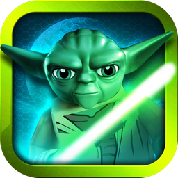
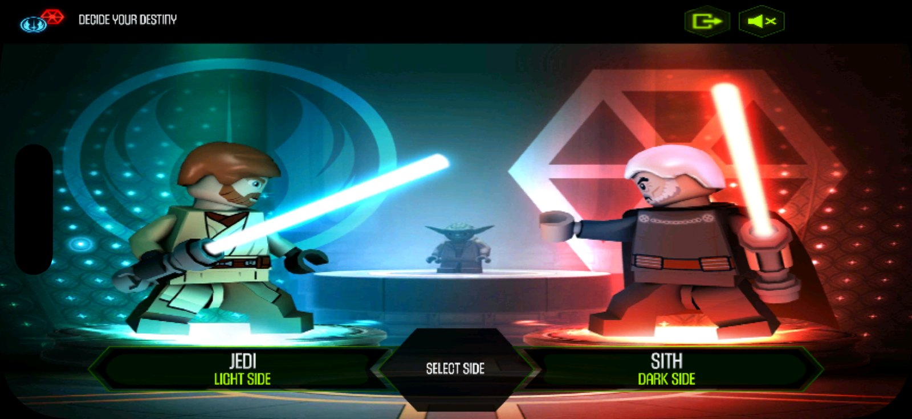
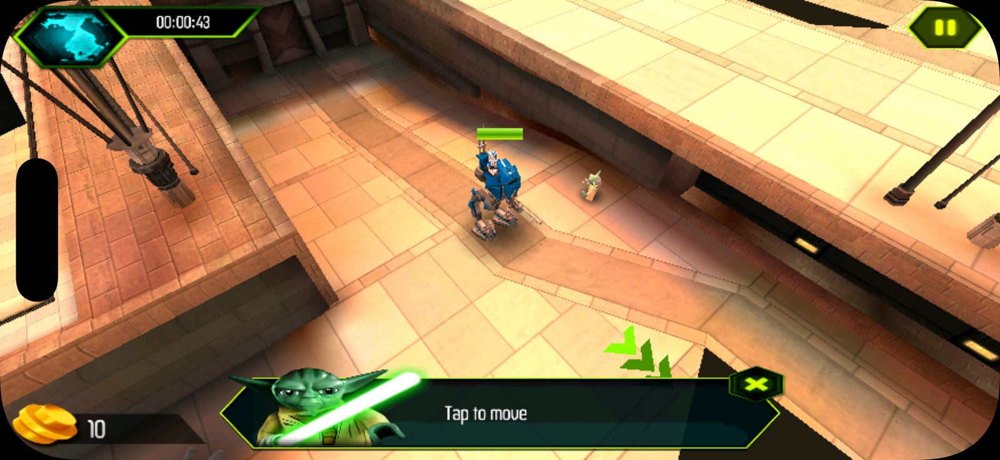
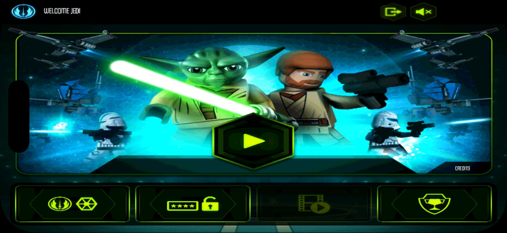
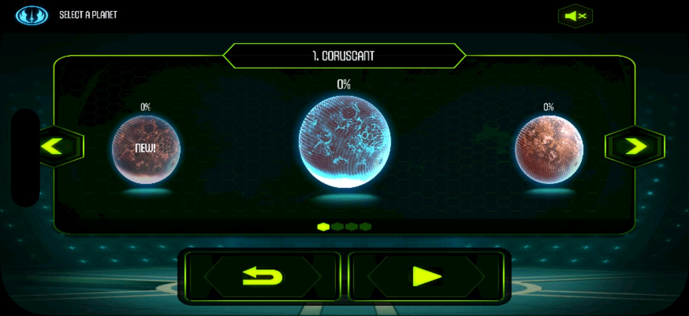
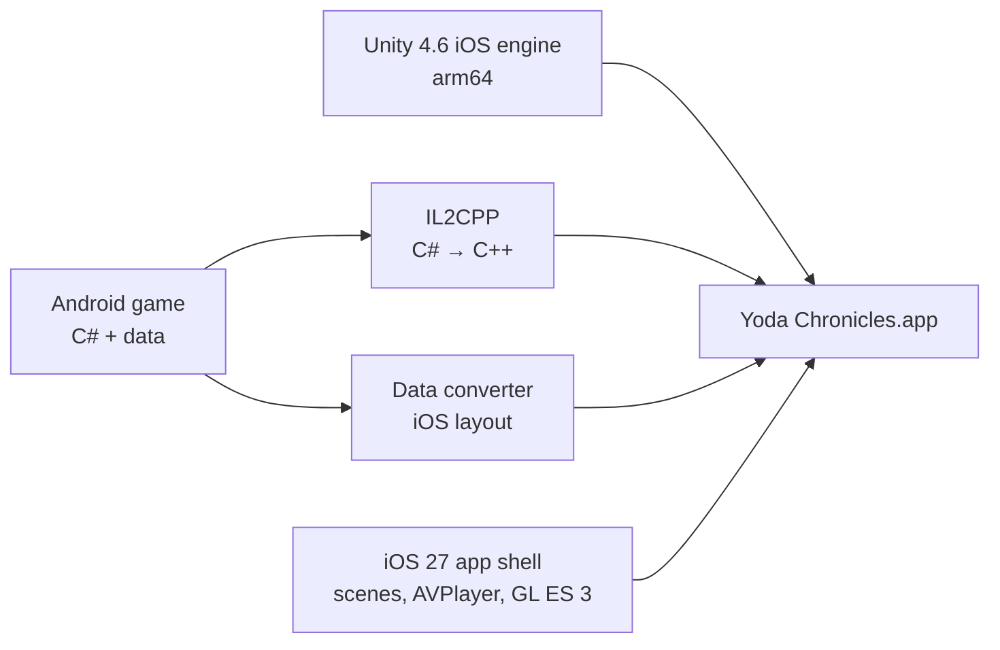

<p align="center">
  
</p>

<h1 align="center">Yoda Chronicles for iOS</h1>

<p align="center">
  LEGO® Star Wars™: The Yoda Chronicles, running natively on iPhone 17 and iOS 27.
</p>

<p align="center">
  
  
  
  
</p>

<p align="center">
  
  
</p>

The Yoda Chronicles disappeared from iPhones with the end of 32-bit apps. This project turns the game's final
release back into a native iOS app: the original code, compiled for 64-bit, with the original levels, cutscenes,
music and touch controls. It installs like any other app built in Xcode and needs no jailbreak or emulator.

## Features

- **The original game.** The game's own code and data, compiled ahead of time for arm64, so no reimplementation and
  no emulation.
- **The full final release.** Version 10.0.31: all 28 scenes and 28 cutscenes, both the Jedi and the Sith campaign.
- **Native on current iPhones.** Full 2622 × 1206 resolution on iPhone 17, with the HUD inside the rounded corners
  and clear of the Dynamic Island.
- **Touch controls as designed.** Tap to move, build units, open the map, the way the game was made to be played.
- **Saves that stay.** Progress is stored on the device and survives app updates.
- **Built for development.** A Simulator build, scripted test taps and one-command install on a connected iPhone.

<p align="center">
  
  
</p>

## Requirements

- A Mac with Xcode 27, [XcodeGen](https://github.com/yonaskolb/XcodeGen), Homebrew `mono` and `gcc`, and Python 3
- An iPhone with iOS 26 or later (tested on iPhone 17 with iOS 27), or the iOS Simulator
- Your own copy of the Android game, version 10.0.31 (APK and OBB)
- Unity 4.6.6 for Mac from Unity's download archive (only unpacked, never installed)

| File | SHA-256 |
|---|---|
| `LEGO-Star-Wars-The-Yoda-Chronicles-v10-0-31.apk` | `1c777beb5db7fa97c6bad298c92d53b968a5c7f69474d870e7b30e1bfbb1ae74` |
| OBB `main.10.com.lego.starwars.theyodachronicles.obb`, zipped | `abd563b3e379851f6bfc1c548fd5d89c3a162bfae6a727dadbb988c612d7649f` |
| `unity-4.6.6.dmg` | `0a38e4835eb0b9f5444e86d15f82d952e4490a7591fa7b094245244e21e32233` |

## Getting started

```sh
# 1. Your game files and Unity's installer
mkdir -p input/x/apk input/x/obb input/x/obbx build/unity-4.6.6
unzip yoda.apk -d input/x/apk && unzip yoda-obb.zip -d input/x/obb
unzip input/x/obb/*/main.10.*.obb -d input/x/obbx
hdiutil attach -readonly -mountpoint build/unity-4.6.6/mnt unity-4.6.6.dmg
pkgutil --expand-full build/unity-4.6.6/mnt/Unity.pkg build/unity-4.6.6/pkg

# 2. Build
python3 -m venv tools/.venv && tools/.venv/bin/pip install -r tools/requirements.txt
tools/build_managed.sh && tools/make_data.sh && tools/make_xcode.sh
(cd ios && xcodegen generate)

# 3. Play: in the Simulator, or on your iPhone (set DEVELOPMENT_TEAM in ios/project.yml first)
tools/run_sim.sh 60
tools/run_phone.sh
```

The app is built from your files on your Mac and installed on your own devices. If you also have the original iOS
version, its App Store artwork becomes the app icon (`input/x/ipa/iTunesArtwork`).

## How it works

The Android release is a Unity game: its logic is C# and its levels are Unity data files. This project uses the
tools Unity itself provided when iPhones moved to 64-bit.



- **Game code**: the Android build's C# assemblies go through Unity 4.6.6's own IL2CPP compiler into C++, which Xcode
  compiles for arm64.
- **Engine**: Unity 4.6.6's own arm64 iOS player, unchanged, linked with the C++ runtime it was built for.
- **Data**: the Android data files are rearranged into the iOS layout; a few textures in Android-only formats are
  converted once.
- **App shell**: Unity's iOS app shell, updated for iOS 27 (scene life cycle, AVPlayer cutscenes, OpenGL ES 3).

The technical report covers every step, with the problems found on the way and the test switches:
[`docs/m3-m5-sim-report.md`](docs/m3-m5-sim-report.md).

## Status

| | |
|---|---|
| iPhone 17, iOS 27 | Plays: menus, missions, cutscenes, saves. Coruscant mission 1 played start to finish |
| iOS Simulator | Runs for development (renders at 1× because the Simulator draws OpenGL ES in software) |
| Next | More missions and planets played through |

## Project layout

| Path | Contents |
|---|---|
| `tools/` | the build pipeline: C# patching and IL2CPP, data conversion, Xcode project assembly, run scripts |
| `ios/` | Xcode project definition, app shell additions (`Shim/`), changes to Unity's app shell (`trampoline/`) |
| `docs/` | technical report, design document, input hashes, screenshots |

## Legal

This repository contains only original tooling. No game code, game data or Unity code is included, and nothing
generated from them is committed: you need your own copy of the game and Unity's installer. This is a personal
preservation project and is not affiliated with or endorsed by the LEGO Group, Lucasfilm, Disney, Warner Bros. Games,
TT Games or Unity Technologies. LEGO is a trademark of the LEGO Group, Star Wars is a trademark of Lucasfilm Ltd.,
and Unity is a trademark of Unity Technologies.

## Credits

Made by **Miró Waltisberg**, with [Claude Code](https://claude.com/claude-code) as pair programmer.
Code under the [MIT license](LICENSE).

Also by Miró: [**Ninjago Tournament for iOS**](https://github.com/mirowaltisberg/ninjago-recomp).
