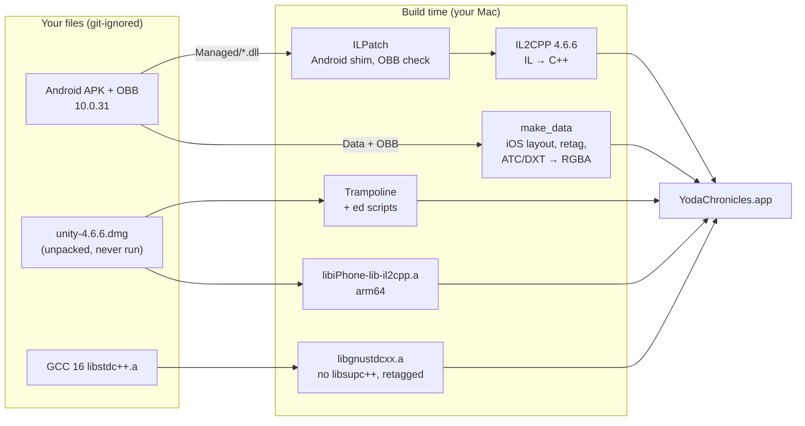

# LEGO Star Wars: The Yoda Chronicles, brought back to iOS

**A 2013 Unity game that stopped running on iPhones with iOS 11, playable again on an iPhone 17 with iOS 27.**
The game's original C# is translated ahead of time to native arm64 code with Unity's own 2015 IL2CPP compiler,
linked against Unity 4.6's own iOS engine, and fed the Android build's original data. No reimplementation, no
emulator, no JIT.

<p align="center">
  
  
</p>

> **No game code or data is in this repository, and no Unity code.** You need your own copy of the Android game
> (version 10.0.31) and Unity's free 4.6.6 installer. Everything translated or converted from them is generated on
> your machine and never committed. This is a personal preservation project, not affiliated with the LEGO Group,
> Lucasfilm, Disney, Warner Bros. Games, TT Games or Unity Technologies.

## Why this was hard

The Yoda Chronicles left the App Store long ago. The last iOS build is 32-bit only; the last Android build
(10.0.31, 2016) is the newest content, but it is a Unity game whose logic is C# bytecode run by Mono's JIT.

| Wall | Why it matters | What this project does |
|---|---|---|
| **No 32-bit apps since iOS 11** | The only iOS binary is ARMv7. | Uses the Android build's C# instead and compiles it for arm64. |
| **No JIT on iOS** | On Android, Mono compiles the game at run time, so there is no fixed machine code to translate. | IL2CPP (Unity 4.6.6, run headless under Mono 6.14) turns all of the game's IL into C++ ahead of time. |
| **A 2015 engine on a 2027 SDK** | Unity 4.6's iOS player was built against GCC's libstdc++, iAd and `MPMoviePlayerViewController`; iOS 27 has none of these and requires the UIScene life cycle. | GNU libstdc++ from GCC 16 linked in beside libc++, a modernised app shell, cutscenes on AVPlayer, a scene delegate. |
| **The data is for Android** | Files tagged "Android" and "4.6.6p1", a Google Play download check, a Qualcomm-only font texture. | Headers retagged, the download check satisfied truthfully, the textures decoded to RGBA once. |

## Results

| | |
|---|---|
| On the iPhone 17 | native **2622×1206**, OpenGL ES 3.0 on the A19 GPU, engine up in about 1 s; Coruscant mission 1 played to the win screen with real touch |
| Game code | **168 C++ files (274 MB)** generated by IL2CPP in 16 s, plus 6,398 engine internal calls registered |
| Game data | all **28 scenes** and **28 cutscenes** of the Android build; 632 serialized files retagged, 3 textures converted |
| Engine | Unity 4.6.6f2's own arm64 iOS player, unmodified; 157 native classes registered |
| C++ runtime | the 98 GNU libstdc++ symbols the 2015 engine needs, from GCC 16, without a second exception runtime |
| App shell | 15 of Unity's Trampoline files changed, stored as additions-only `ed` scripts |
| Also | intro and mission movies, saves that survive updates, the original app icon, a Simulator build for testing |

## How it works



- **Managed side** (`tools/build_managed.sh`): replays what Unity 4.6.6's editor did for an iOS IL2CPP build, recovered
  from `UnityEditor.dll`: swap in the iOS `UnityEngine.dll`, run `AssemblyPatcher` on mscorlib, run `il2cpp.exe` and
  the internal-call registration writer. `tools/ilpatch` (Mono.Cecil) retargets the three Android-only engine types
  to an inert shim assembly and answers the Google Play download check.
- **Data** (`tools/make_data.sh`): APK and OBB into the iOS `Data/` layout, split files joined, movies to
  `Data/Raw`, file headers retagged from Android/4.6.6p1 to iPhone/4.6.6f2, Adreno and desktop textures decoded.
- **Native side** (`tools/make_xcode.sh`, `ios/project.yml`): Unity's Trampoline plus `ios/trampoline/*.ed`, the
  generated registration files, the arm64 engine library, the GNU libstdc++ subset and `ios/Shim/`.
- **Run it**: `tools/run_sim.sh` (Simulator), `tools/run_phone.sh` (iPhone).

## The hard parts

**The Android build only starts on Android.** After the splash, the game waits for a signal that only
`SendSignalsOnAwakeCheckPlatform` sends, and only when "running on Android and the Google Play expansion file is
present". The iOS build had its own branch, compiled out of this one. `GooglePlayDownloader` now reports exactly what
is true: the data is all there.

**A C++ library that iOS no longer has.** The 2015 engine calls GNU's copy-on-write `std::string`, iostreams and
locale code (98 symbols). GCC 16 still ships that ABI. Its `libsupc++` half is left out so exceptions and RTTI stay with
iOS's libc++abi; two GNU-only pieces it then lacks (`ios_base::failure` throwing, the `__forced_unwind` typeinfo) are
provided in `ios/Shim/GnuRuntime.cpp`. One engine function that receives a GNU `std::string` gets a hand-written bridge.

**Objects that say "iPhone" in the Simulator.** 175 of the engine's 2,102 objects carry a 2015 iOS version
command and the linker refuses them for the Simulator. `tools/arsim.py` removes that 16-byte command in place, so the
archive layout and its symbol table stay valid; the rest already had no platform tag at all.

**Exact versions or nothing.** The player refuses data from "another build target" and from any other engine
version. Both are header fields of the same length, so they are rewritten in place: Android → iPhone,
4.6.6p1 → 4.6.6f2 (the bug-fix patch on top of the engine that is still downloadable).

**iOS 26+ hates swapping root view controllers.** Unity forces orientation by moving its one view between
orientation-locked controllers and making each the window's root. Modern UIKit runs a presentation transition on
every root swap and crashes on it. The window now gets one permanent root; Unity's controllers become its children.

**A movie player that shows one frame.** `MPMoviePlayerViewController` still exists on iOS 27 but never plays.
The engine relies on its autoplay and its "did finish" notification; the replacement plays with AVPlayer behind the
same interface, so the engine code is unchanged and tap-to-skip still works through `stop`.

**Invisible text.** The game font's distance-field atlas is ATC, a Qualcomm Adreno format, and the engine's
fallback decoder fails on it. Decoded once to RGBA32 while assembling the data, the multi-channel pages come back.

**The Simulator draws in software.** At native 3× the splash screen took seconds per frame. The Simulator renders at
1×; the phone at full resolution.

## Building it yourself

You need a Mac with Xcode 27, [XcodeGen](https://github.com/yonaskolb/XcodeGen), Homebrew `mono` and `gcc`,
Python 3, your own copy of the Android game, and Unity 4.6.6 from Unity's archive:

| File | SHA-256 |
|---|---|
| `LEGO-Star-Wars-The-Yoda-Chronicles-v10-0-31.apk` | `1c777beb5db7fa97c6bad298c92d53b968a5c7f69474d870e7b30e1bfbb1ae74` |
| its OBB `main.10.com.lego.starwars.theyodachronicles.obb`, zipped | `abd563b3e379851f6bfc1c548fd5d89c3a162bfae6a727dadbb988c612d7649f` |
| `unity-4.6.6.dmg` (download.unity3d.com) | `0a38e4835eb0b9f5444e86d15f82d952e4490a7591fa7b094245244e21e32233` |

```sh
# 1. Your game files and Unity's installer, unpacked only (the 4.x editor is 32-bit and is never run)
mkdir -p input/x/apk input/x/obb input/x/obbx build/unity-4.6.6
unzip yoda.apk -d input/x/apk && unzip yoda-obb.zip -d input/x/obb
unzip input/x/obb/*/main.10.*.obb -d input/x/obbx
hdiutil attach -readonly -mountpoint build/unity-4.6.6/mnt unity-4.6.6.dmg
pkgutil --expand-full build/unity-4.6.6/mnt/Unity.pkg build/unity-4.6.6/pkg

# 2. Tools, then the pipeline
python3 -m venv tools/.venv && tools/.venv/bin/pip install -r tools/requirements.txt
tools/build_managed.sh && tools/make_data.sh && tools/make_xcode.sh
(cd ios && xcodegen generate)

# 3. Simulator, or your iPhone (automatic signing; set DEVELOPMENT_TEAM in ios/project.yml)
tools/run_sim.sh 60
tools/run_phone.sh
```

The optional app icon is taken from the iOS IPA (`input/x/ipa/iTunesArtwork`) if you have it. The phone build bundles
your data, so it stays on your own devices. Findings, test switches and the full log of what blocked and why:
[`docs/m3-m5-sim-report.md`](docs/m3-m5-sim-report.md).

<p align="center">
  
  
</p>

## Repository map

| Path | What |
|---|---|
| `tools/ilpatch/` | Mono.Cecil patcher and the Android shim assembly |
| `tools/build_managed.sh` | the editor's IL2CPP pipeline, headless |
| `tools/make_data.sh`, `retarget_data.py`, `convert_textures.py` | Android data → iOS player data |
| `tools/make_gnustdcxx.sh`, `machotag.py`, `arsim.py` | GNU libstdc++ subset, Mach-O platform retagging |
| `tools/make_xcode.sh`, `save_trampoline_patch.sh` | Xcode tree from Unity's Trampoline + `ios/trampoline/` |
| `tools/run_sim.sh`, `watch_sim.sh`, `run_phone.sh` | run, screenshot (with the device mask) and test |
| `ios/` | `project.yml` (Simulator and iPhone targets), `Shim/` (scene delegate, GNU bridge, developer taps), `trampoline/` |
| `docs/` | design, input hashes, the milestone report, screenshots |

## License and credits

The code in this repository is MIT licensed, see [LICENSE](LICENSE). LEGO and the LEGO logo are trademarks of the
LEGO Group; Star Wars is a trademark of Lucasfilm Ltd.; Unity is a trademark of Unity Technologies. The game and the
Unity engine belong to their rights holders and are not included.

Built by **Miró Waltisberg**, with [Claude Code](https://claude.com/claude-code) as pair programmer.
Sister project: [ninjago-recomp](https://github.com/mirowaltisberg/ninjago-recomp).
